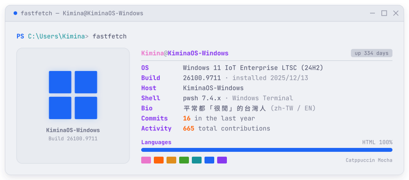
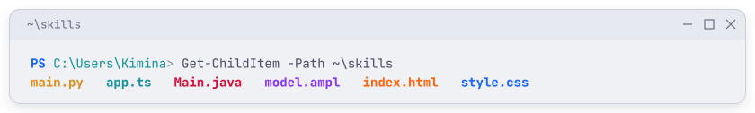

<!--
  這個主頁裡的圖片都是由 scripts/generate.py 繪製。
  改文字：編輯 config.toml 並提交，GitHub Actions 會自動重新生成（約 1 分鐘）。
  數據卡片（fastfetch、熱力圖）每天自動更新。
-->

<picture>
  <source media="(prefers-color-scheme: dark)" srcset="https://raw.githubusercontent.com/KiminaNatsuki/KiminaNatsuki/main/assets/header-dark.svg?v=4">
  
</picture>

  <picture>
    <source media="(prefers-color-scheme: dark)" srcset="https://raw.githubusercontent.com/KiminaNatsuki/KiminaNatsuki/main/assets/badge-teto-dark.svg?v=4">
    
  </picture>&nbsp;
  <picture>
    <source media="(prefers-color-scheme: dark)" srcset="https://raw.githubusercontent.com/KiminaNatsuki/KiminaNatsuki/main/assets/badge-os-dark.svg?v=4">
    
  </picture>&nbsp;
  <picture>
    <source media="(prefers-color-scheme: dark)" srcset="https://raw.githubusercontent.com/KiminaNatsuki/KiminaNatsuki/main/assets/badge-locale-dark.svg?v=4">
    
  </picture>&nbsp;
  

<picture>
  <source media="(prefers-color-scheme: dark)" srcset="https://raw.githubusercontent.com/KiminaNatsuki/KiminaNatsuki/main/profile/neofetch-dark.svg?v=4">
  
</picture>

<picture>
  <source media="(prefers-color-scheme: dark)" srcset="https://raw.githubusercontent.com/KiminaNatsuki/KiminaNatsuki/main/assets/skills-dark.svg?v=4">
  
</picture>

<picture>
  <source media="(prefers-color-scheme: dark)" srcset="https://skillicons.dev/icons?i=py,java,ts,js,html,css,vscode,windows,git,github&theme=dark">
  
</picture>

<picture>
  <source media="(prefers-color-scheme: dark)" srcset="https://raw.githubusercontent.com/KiminaNatsuki/KiminaNatsuki/main/profile/activity-dark.svg?v=4">
  
</picture>

<!-- Discord Status -->

  &nbsp;
  

<picture>
  <source media="(prefers-color-scheme: dark)" srcset="https://raw.githubusercontent.com/KiminaNatsuki/KiminaNatsuki/main/assets/footer-dark.svg?v=4">
  
</picture>

